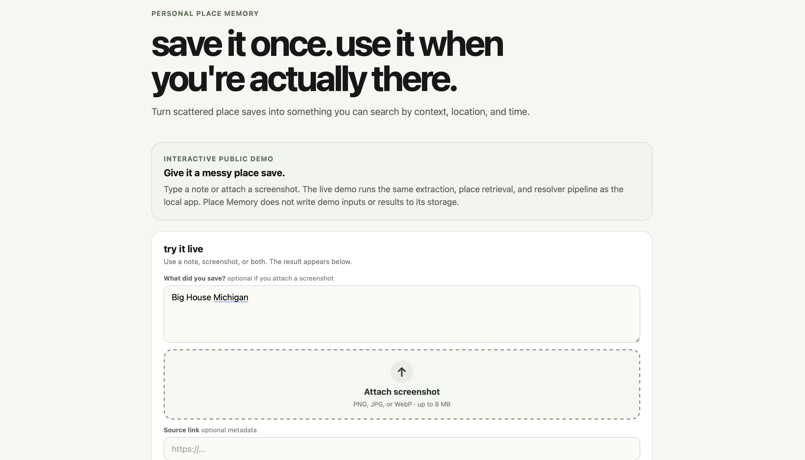
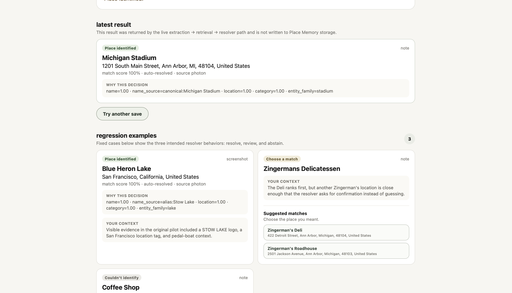
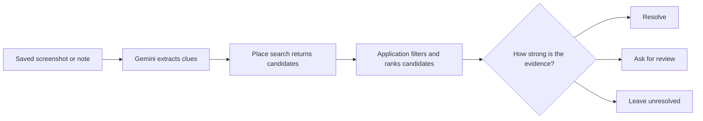

# Place Memory

Turn a saved screenshot, note, caption, or link into a place you can find again.

[Hosted demo](https://place-memory-caxs.onrender.com) · [Architecture](docs/architecture.md) · [Field test](docs/field-test-2026-09-17.md) · [Evaluations](#evaluations) · [Run locally](#run-locally)

Gemini extracts clues, a place-search provider returns real candidates, and application code decides whether the evidence supports a match. If the evidence is weak or conflicting, Place Memory asks for review or leaves the save unresolved.



**Start with the Stow Lake example.** A screenshot used the lake's former name and pulled in unrelated roads. Adding provider-backed aliases and filtering incompatible candidates let the resolver identify Blue Heron Lake. The [before-and-after field test](docs/field-test-2026-09-17.md) shows the evidence behind that decision.

The hosted demo includes built-in examples for all three outcomes. Live demo inputs may be sent to external providers for processing. The demo does not save visitor inputs or results to Place Memory storage.

## How it works



The resolver weighs name, location, category, provider-backed aliases, and the gap between the strongest candidates. In local mode, the app saves the decision and the evidence behind it.

## Why the resolver is separate from the model

The first version relied too much on fuzzy matching and clean examples. Real tests exposed problems quickly:

- a generic "coffee shop" note could produce junk global candidates
- duplicate OSM records could make one real place look ambiguous
- missing evidence could still add confidence
- a manual confirmation could later look like an automatic decision
- roads and boundaries could survive into place review
- renamed places could look like weak string matches even when the old name was valid

Those failures changed the design.

The current resolver has:

- an explicit no-identity abstention path
- hard filtering for incompatible entity classes
- duplicate collapse before ambiguity is measured
- separate `auto`, `manual`, and `abstained` provenance
- preserved pre-confirmation score and candidate gap
- a finite category compatibility table rather than fuzzy category matching
- independent-evidence requirements for automatic resolution
- provider-backed alternate / historical names
- an explanation endpoint that exposes the evidence used for each decision

## A real example

A TikTok screenshot contained a small `STOW LAKE` logo, a San Francisco location tag, and text about renting a pedal boat.

On the first live run, the system retrieved the current `Blue Heron Lake` record but only scored it at `0.6471`, mixed in road objects, and correctly required manual confirmation.

That run exposed three separate issues:

1. `Stow Lake` is a historical name for the current place
2. "boat rental" described an activity, not the identity type of the lake
3. road objects should not survive as place candidates

After fixing those issues, the same screenshot was run again. The saved explanation showed:

```text
canonical place: Blue Heron Lake
resolution method: auto
match score: 1.0
name source: alias:Stow Lake
location: 1.00
category: 1.00
```

The before/after run is documented in [`docs/field-test-2026-09-17.md`](docs/field-test-2026-09-17.md).

The persistent local app preserves the original screenshot alongside the interpreted result. Optional user text stays separate from the model's extracted evidence. A backend restart verified that the saved screenshot and its memory remained linked.

## Evaluations

I keep controlled resolver tests separate from live product evidence.

### Synthetic resolver cases

```bash
python evals/run_resolution_eval.py
```

Current fixture results:

| metric | result |
| --- | ---: |
| cases | 12 |
| top-1 accuracy on labeled cases | 100% |
| automatic-resolution precision | 100% |
| recall on cases labeled safe to auto-resolve | 100% |
| false automatic resolution rate | 0% |
| review / abstain rate | 50% |

### Field regression scenarios

```bash
python evals/run_field_resolution_eval.py
```

Current fixture results:

| metric | result |
| --- | ---: |
| distinct scenarios | 6 |
| decision-mode accuracy | 100% |
| top-1 accuracy on labeled cases | 100% |
| false automatic resolution rate | 0% |

These are small regression sets, not a claim about production accuracy. The next evaluation pass is a curated set of real artifacts with stage-level labels for extraction, candidate recall, ranking, decision mode, and false automatic resolution.

See [`evals/README.md`](evals/README.md).

## Stack and deployment

- React + TypeScript + Vite
- FastAPI + Pydantic
- Gemini Developer API for text / screenshot interpretation
- Photon for no-key candidate search
- Nominatim `/lookup` for OSM alias metadata
- RapidFuzz + explicit resolver policy
- SQLite + local artifact storage
- optional MCP adapter
- pytest + GitHub Actions
- Docker / Docker Compose

Google Places / Routes remain optional. Routing uses destination coordinates so a Photon/OSM ID is never passed to Google as if it were a Google place ID. Opening-hours lookup only runs when a compatible Google place identity exists; otherwise the result stays unknown.

The public demo runs on Render. Local mode uses SQLite and local screenshot storage. The [GCP and Terraform notes](infra/README.md) describe a proposed production deployment.

## Run locally

The direct setup uses Python 3.12 and Node.js 22, matching [CI](.github/workflows/api-tests.yml).

### Docker Compose

```bash
cp .env.example .env
docker compose up --build
```

Open `http://localhost:5173`.

Screenshot extraction requires `GEMINI_API_KEY`. Google credentials are optional.

### Direct processes

Backend:

```bash
cd api
python -m venv .venv
# Windows: .venv\Scripts\activate
# macOS/Linux: source .venv/bin/activate
pip install -r requirements.txt
cp .env.example .env
uvicorn app.main:app --reload --port 8000
```

Frontend:

```bash
cd web
npm ci
npm run dev
```

Open `http://localhost:5173`. Text notes can use the fallback parser without a Gemini key. Add `GEMINI_API_KEY` to `api/.env` to enable model-based extraction from notes and screenshots.

### Run the backend tests

From `api/` with the virtual environment active:

```bash
python -m pytest -q
```

## API highlights

- `POST /api/memories/ingest`
- `POST /api/memories/ingest-image`
- `GET /api/memories/{id}/source-image`
- `POST /api/memories/{id}/confirm`
- `POST /api/memories/{id}/reject`
- `GET /api/memories/{id}/resolution`
- `POST /api/feasible`

## Current limits

This is still an engineering prototype, not a production service.

- screenshot storage is local filesystem storage behind a small storage boundary; it is not a durable cloud-object-store design
- the real-artifact evaluation set is still small
- provider recall is not yet measured on a broad enough real set to justify more retrieval infrastructure
- opening-hours data is unavailable when there is no compatible status-provider identity
- SQLite + local files are appropriate for the current local single-user version, not multi-user production storage
- a public deployment would need user isolation before accepting private screenshots

The next pass is the **curated real-artifact pilot**, followed by fixes only where that pilot exposes a real gap.
